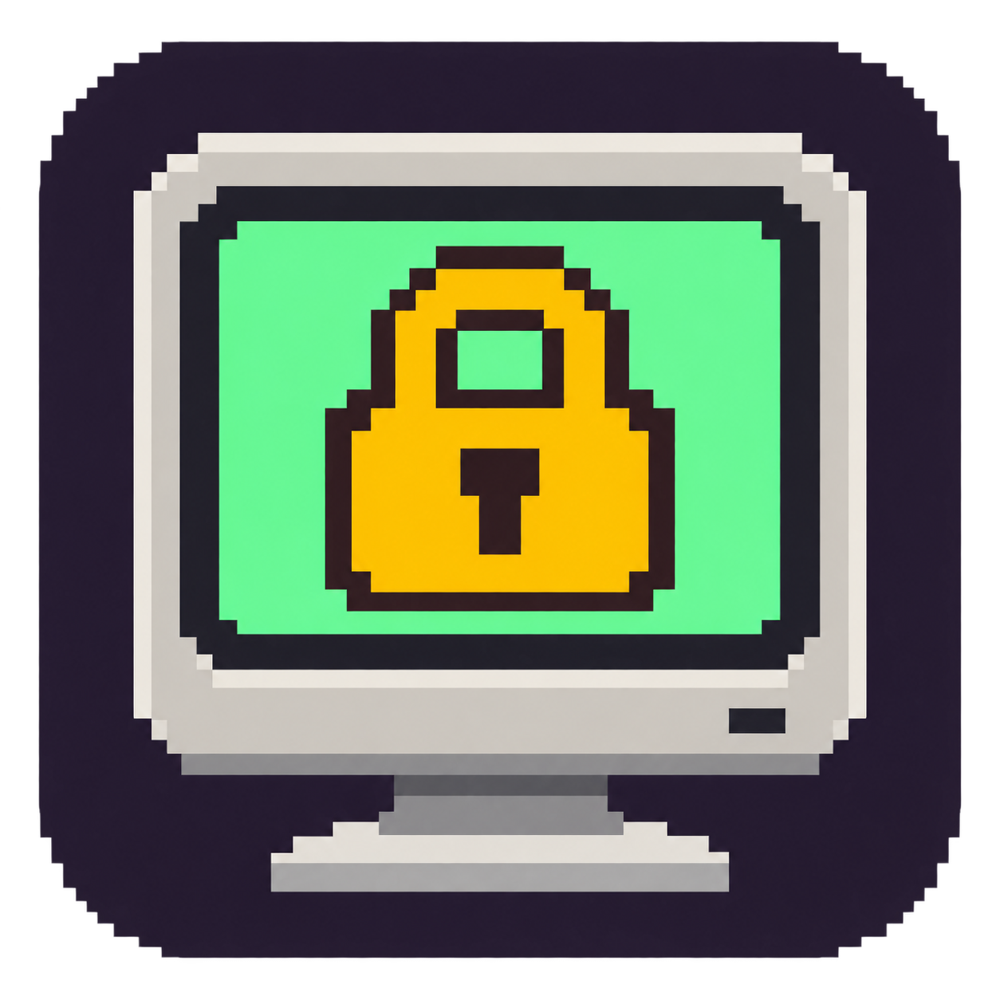

# Mac Input Guard

**[English](#english) | [简体中文](#简体中文)**



Keep AI working on your Mac while limiting casual physical input.

让 AI 继续操作 Mac，同时限制身边的人使用实体键盘、鼠标和触控板。

## English

Keep AI working on your Mac while limiting casual physical keyboard, mouse, and trackpad input.

Mac Input Guard is a small macOS menu bar app. Your desktop remains visible. When you step away, press **Control + Option + Command + L** to enable input protection; use your independent protection password to unlock it when you return. Optional login startup stays idle in the background and never enables protection automatically.

**Current version: 0.1.0-alpha.1.** This early preview is intended for users willing to complete compatibility checks on their own Mac. The application UI is currently Chinese; this documentation is available in English and Simplified Chinese.

**Source-only release:** prebuilt apps will be provided after Developer ID signing, notarization, and release acceptance. CI builds and tests the source without uploading development installers.

### Features

- Limit ordinary physical keyboard and mouse input, two-finger scrolling, and three-/four-finger desktop switching.
- Keep the screen visible, without a fullscreen cover, recurring focus grabs, or suspension of builds, tests, or other background processes.
- Use an independent protection password. Change it by verifying the old password, or reset it after verifying the current local Mac account's login password.
- Store a salted password verifier in the local Keychain, rather than the protection password in plaintext.
- Try a preview that automatically ends after 12 seconds. Complete the local compatibility review before enabling regular protection.
- Keep input filtering in a child process. Release input if parent/child heartbeats or the lease fail. Manual sleep, display sleep, or session deactivation also ends protection.

### Installation and first use

For now, build from source using the commands below, then run `./scripts/install.sh` to install into your user's Applications directory. When notarized installers are available, you will also be able to drag `MacInputGuard.app` from the disk image into `Applications`.

1. Set your own protection password locally. The minimum is three characters; choose a longer password that you do not reuse for another account.
2. Add and enable **MacInputGuard** in **System Settings → Privacy & Security → Accessibility**. The app's **辅助功能设置** (Accessibility settings) button opens the settings page; you must grant access yourself.
3. Run **测试 12 秒** (12-second test). Check that physical input is blocked and automatically restored after the full countdown. A test starts only while the display is awake and the session is unlocked.
4. Use further bounded tests to check the unlock dialog, trackpad, and your usual AI automation. Compare the same operation with protection off and on: anything that worked before should still work during protection.
5. Open **兼容性检查** (Compatibility review), select only the items you personally verified, and save. Results from another Mac cannot replace your checks.
6. Optionally enable **登录后在后台待命** (Start idle in the background at login). Use the shortcut when leaving, and enter your protection password in the small unlock window when returning. During protection, the shortcut only shows the unlock window; it does not unlock the app.

Click **结束测试** (End test) to stop a preview early. An early stop does not satisfy the full 12-second automatic-recovery check. The app will not report regular protection as successful when permissions are missing, the compatibility review is incomplete, or filter health has failed.

The app does not prevent sleep or change system sleep, auto-lock, or password policies.

The retro pixel icon is included in the application bundle for Finder and the Dock.
The installer replaces the complete app and refreshes macOS application registration
when updating. See [icon artwork and regeneration](resources/README.md).

### Build and test

Requires macOS 13 or later, Xcode Command Line Tools (including the Swift compiler), and Python 3. The built app does not require Python, Codex, or a network service to run.

```sh
./scripts/build.sh                 # Universal: Apple silicon + Intel
./scripts/test.sh                  # No posted events or physical-input interception
./scripts/package.sh --skip-build  # DMG, app ZIP, source ZIP, SHA-256 checksums
./scripts/install.sh               # Install into the current user's Applications
```

You can also build a single architecture with `./scripts/build.sh arm64` or `./scripts/build.sh x86_64`. Tests use fictitious passwords. Keychain tests use randomly named UUID test entries and delete them afterward; they do not read an existing user's password record.

```sh
./scripts/control.sh status
./scripts/control.sh diagnostics
./scripts/control.sh setup
./scripts/control.sh preview       # 12 seconds; refuses to replace regular protection
```

See [distribution instructions](docs/DISTRIBUTION.md) for signing, notarization, and release steps. A development build without a Developer ID signature is not a notarized release. Gatekeeper may block an internet-downloaded development build. Do not disable system security protections to open it.

### AI tool integration

The app does not require a Codex skill. If you want accompanying Codex workflow guidance, review the [optional skill](integrations/codex/SKILL.md) and [global-instruction fragment](integrations/codex/AGENTS.fragment.md), then decide whether to install them yourself.

For browser pages, prefer exact tab bindings and compare page state with tab screenshots. For Finder Desktop icons, prefer an exposed Open action. These are workflow mitigations for observed native-tool limitations, not changes to browser or Codex internals.

### Local data and uninstalling

Local status and compatibility approval are stored in `~/Library/Application Support/MacInputGuard/`. The password verifier is stored in the current user's local Keychain. The app has no analytics, automatic updater, network endpoint, or key-text logging. See [privacy and security boundaries](docs/SECURITY.md).

Unlock protection yourself and quit the app from its menu bar before uninstalling:

```sh
./scripts/uninstall.sh
```

The script disables this app's login startup and moves the app to Trash. It retains your local password verifier and configuration for reinstalls. To remove those as well, manually delete the app's data directory and, in Keychain Access, the entry for service `org.macinputguard.password-verifier`. Do not delete other apps' data.

### Compatibility and limits

This is a convenience tool that discourages casual local interaction, **not a secure macOS system lock**. It does not hide screen content. Administrators, process termination, restart, input-injection tools, and some system hardware actions can bypass it. Input source metadata is not an authentication credential.

Distinguishing physical trackpad events from automation depends on the OS, hardware, and automation backend. Compatibility with every Mac, AI tool, or remote-control method is not guaranteed. Each Mac needs its own bounded checks, and an OS version change requires renewed confirmation. Compilation for an architecture does not establish hardware acceptance. See [testing and acceptance](docs/TESTING.md).

### License

[MIT License](LICENSE).

---

## 简体中文

让 AI 继续操作 Mac，同时限制身边的人使用实体键盘、鼠标和触控板。

这是一个 macOS 菜单栏小工具：桌面保持可见，用户离开时按 **Control + Option + Command + L** 开启输入保护，返回后使用自己设置的独立密码解除。登录启动只在后台待命，不会自动开启保护。

**当前版本：0.1.0-alpha.1。** 面向愿意完成本机兼容性检查的早期使用者。当前应用界面为中文。

当前仅公开源码。预编译 App 将在完成 Developer ID 签名、公证和发布验收后提供；CI 只编译与测试，不上传开发版安装包。

### 能做什么

- 限制普通实体键盘、鼠标点击、两指滚动和三／四指桌面切换。
- 不遮住屏幕、不循环抢回焦点、不暂停编译、测试或其他后台进程。
- 使用独立保护密码；支持验证旧密码修改，或由本机账户登录密码验证后重设。
- 使用钥匙串保存加盐的密码校验记录，不保存保护密码明文。
- 提供 12 秒自动结束的预览；正式启用前，由使用者完成本机兼容性检查。
- 子进程持有输入过滤器，父子心跳或租约失效时释放输入；手动睡眠、熄屏或会话停用也会结束保护。

### 安装和首次使用

目前请按下方步骤自行构建，并运行 `./scripts/install.sh` 安装到当前用户的 Applications 目录。等提供已公证安装包后，也可以将其中的 `MacInputGuard.app` 拖入 `Applications`，然后打开。

1. 在本机设置自己的保护密码，至少 3 个字符；建议使用更长且不与其他账户共用的密码。
2. 在“系统设置 → 隐私与安全性 → 辅助功能”中添加并开启 **MacInputGuard**。程序中的“辅助功能设置”按钮只打开设置页，不能代替你的授权。
3. 运行“测试 12 秒”，确认实体输入被拦住、完整计时后自动恢复。测试只在屏幕亮且会话已解锁时启动。
4. 继续用限时测试检查解锁小窗、触控板和自己常用的 AI 操作；以“未保护时能做的事，保护期间仍能做”为标准。
5. 进入“兼容性检查”，仅勾选亲自确认的项目并保存。其他电脑的测试记录不能替代你的检查。
6. 需要时开启“登录后在后台待命”。离开时用快捷键开启保护，返回后在小窗输入保护密码。快捷键在保护期间只显示解锁窗口，不会直接解除保护。

短按“结束测试”可提前结束预览；提前结束不会满足“完整 12 秒自动恢复”检查。缺少权限、兼容性检查未完成或检测到过滤器失效时，程序不会报告正式保护成功。

本工具不附带防休眠功能，也不改变系统休眠、自动锁屏或密码策略。

复古像素图标已写入应用包，供 Finder 和 Dock 使用；安装脚本更新时替换完整应用包，
并刷新 macOS 应用注册信息。图标原图和重新生成方法见 [图标说明](resources/README.md)。

### 构建和测试

需要 macOS 13 或更高版本，以及 Xcode Command Line Tools（包含 Swift 编译器）和 Python 3。应用运行本身不依赖 Python、Codex 或网络服务。

```sh
./scripts/build.sh                 # Universal: Apple silicon + Intel
./scripts/test.sh                  # 不向桌面发送事件，不开启实体输入拦截
./scripts/package.sh --skip-build  # DMG、App ZIP、源码 ZIP、SHA-256
./scripts/install.sh               # 当前用户 Applications 目录
```

也可以使用 `./scripts/build.sh arm64` 或 `./scripts/build.sh x86_64`。测试中的密码均为虚构值；钥匙串测试条目使用随机 UUID，结束后删除，不读取现有使用者的密码记录。

```sh
./scripts/control.sh status
./scripts/control.sh diagnostics
./scripts/control.sh setup
./scripts/control.sh preview       # 12 秒；拒绝覆盖已有的正式保护
```

签名、公证和发布步骤见 [分发说明](docs/DISTRIBUTION.md)。非 Developer ID 签名的开发构建不等于已公证发行版；通过互联网下载后，Gatekeeper 可能阻止打开。不要为此关闭系统安全保护。

### AI 工具配套

应用本身不要求安装 Codex skill。需要 Codex 配套操作约束时，可以参考 [可选 skill](integrations/codex/SKILL.md) 和 [全局指令片段](integrations/codex/AGENTS.fragment.md)，由使用者自行决定是否安装。

浏览器优先精确绑定标签页，使用页面状态与标签页截图互相核对；Finder 桌面图标优先使用公开的“打开”动作。这些是已观察到的原生工具问题的操作规避方式，不是对浏览器或 Codex 内部实现的修改。

### 数据和卸载

本机状态与兼容性确认保存在 `~/Library/Application Support/MacInputGuard/`。保护密码的校验记录保存在当前用户的本机钥匙串中。没有分析统计、自动更新、联网接口或按键内容记录。详见 [隐私与安全边界](docs/SECURITY.md)。

卸载前，自己解除保护并在菜单栏退出应用，然后执行：

```sh
./scripts/uninstall.sh
```

脚本取消本应用的登录启动并将 App 移到废纸篓；保留本机密码校验记录和配置，以便重新安装。可手动删除本工具的数据目录，并在钥匙串访问中删除服务 `org.macinputguard.password-verifier` 对应的条目，完成彻底清理。不要删除其他应用的数据。

### 兼容性边界

这是防止身边的人随手操作的便利工具，**不是 macOS 系统安全锁**。它不会隐藏屏幕内容；管理员、进程终止、重启、输入注入工具和部分系统硬件操作可能绕过。输入事件来源标记不是认证凭据。

触控板原始事件与自动化事件的区分受系统、设备和自动化后端影响。不能承诺兼容所有 Mac、所有 AI 工具或所有远程控制方式。每台电脑必须自行完成短时检查；系统版本变化后需要重新确认。构建架构支持不等于实机操作验证。

采用 [MIT License](LICENSE)。
